# TCFY 系统架构与模块设计

本文档描述 `PHY4L/TCFY` 的模块边界、核心数据管线、并发模型与持久化契约，作为 [AGENTS.md](../AGENTS.md) 的架构补充参考。

---

## 1. 端到端课堂听译管线

```mermaid
flowchart LR
    MIC["ClassroomAudioCapturer<br/>16kHz Mono PCM16 (20ms/320 samples)<br/>UNPROCESSED → CAMCORDER → MIC"]
    WAV["CrashSafeWavWriter<br/>原始 PCM 持续落盘 + 5s fsync WAV头"]
    DSP["FarFieldDspPipeline<br/>去直流 → 85Hz HPF → GTCRN(干湿混) → 静音冻结AGC → tanh软限幅"]
    VAD["SherpaSileroVadEngine<br/>远场端点检测 (window=512)"]
    CH["chunkChannel (容量32)"]
    PRV["previewChannel (CONFLATED)<br/>低优先级局部预览"]
    ASR["SherpaSenseVoiceEngine<br/>SenseVoice-Small int8 (4线程 CPU)"]
    TERM["OfflineTermCorrector<br/>1.规范词锁定+最长别名 → 2.拼音音近 → 3.英文模糊"]
    TRANS["TranslationRouter<br/>断网离线注译 / 联网4s超时降级 + 占位符术语保护"]
    DB["Room SQLite (tcfy_lectures.db)<br/>LectureSessionEntity / TranscriptSegmentEntity"]
    AI["课后 AI 精修与总结<br/>LectureRefinerAndSummarizer (18段滑窗+3句前文)"]
    EXP["SessionExporter<br/>Markdown / TXT / SRT"]

    MIC --> WAV
    MIC --> DSP --> VAD
    VAD -->|完整语段| CH --> ASR
    VAD -->|实时切片| PRV -.->|仅主ASR空闲时| ASR
    ASR --> TERM --> TRANS --> DB
    DB --> AI --> DB
    DB --> EXP
    WAV -.->|课后更换模型/词库| DSP
```

---

## 2. 包结构与职责边界

根包：`com.phy4l.tcfy`

| 包路径 | 核心文件 | 运行环境边界 | 职责说明 |
| :--- | :--- | :--- | :--- |
| `audio/` | `AcousticPreset.kt`、`FarFieldDspPipeline.kt`、`AudioChunkPreprocessor.kt`、`LiveAcousticAutoTuner.kt`、`CrashSafeWavWriter.kt`、`ClassroomAudioCapturer.kt` | **除 `ClassroomAudioCapturer` 外为纯 JVM** | 声学预设（含 AUTO/轻声/快语速）、远场 DSP 与 PA 抗混响均衡、段级归一化与重叠防截断、实时自适应调参、防崩溃 WAV 与麦克风采集 |
| `asr/` | `AsrInterfaces.kt`、`ModelCatalog.kt`、`MirrorLatencySelector.kt`、`ModelManager.kt`、`SherpaEngines.kt` | **MirrorLatencySelector / ModelCatalog 为纯 JVM**，其余 Android/JNI | 多架构离线 ASR 工厂（SenseVoice / Paraformer-ZH / Whisper-EN / Wenet-Yue）、内置 <1MB 模型释放、多镜像并发测速排序与本地导入 |
| `glossary/` | `GlossaryModels.kt`、`BuiltInGlossaries.kt`、`GlossaryImporter.kt`、`OfflineTermCorrector.kt`、`PhoneticUtils.kt` | **纯 JVM** | 术语数据结构、内置课程词库（分子生物学/物理/CS-AI）、CSV(UTF-8/GBK)/TXT/JSON 导入导出、三层离线纠错与口音模糊音拼音相似度 |
| `ai/` | `LlmPresets.kt`、`OpenAiCompatibleClient.kt`、`TranslationEngine.kt`、`LectureRefinerAndSummarizer.kt`、`LiveGlossaryBuilder.kt` | **纯 JVM** | OpenAI 兼容接口客户端、主流国内模型预设、占位符术语保护与离线保底翻译路由、课后滑窗精修总结与开讲前几分钟 AI 现场建词库 |
| `data/db/` | `Entities.kt`、`Daos.kt`、`TcfyDatabase.kt` | Android / Room | 4 张核心表定义、Flow 响应式 DAO、数据库单例与首次幂等预置词库 |
| `data/prefs/` | `AppSettingsRepository.kt` | Android / DataStore | `tcfy_settings` Preferences DataStore 与 `AppSettings` / `LlmApiConfig` 持久化 |
| `data/export/` | `SessionExporter.kt` | **纯 JVM** | 导出 `.md`、双语 `.txt`、`.srt` 字幕及时间戳格式化 |
| `service/` | `RecordingState.kt`、`RecordingCoordinator.kt`、`RecordingForegroundService.kt` | Android Service | 录音/转写/重转写/自动调参/VAD热重建/现场词库全生命周期协调、前台麦克风通知保活、4 小时 `PARTIAL_WAKE_LOCK` |
| `ui/` | `TcfyApp.kt`、`TcfyViewModel.kt`、`ui/record/`（含 `RecordScrollPolicy.kt`）、`ui/history/`、`ui/glossary/`、`ui/settings/`、`ui/theme/` | Android / Compose | Material 3 单 Activity 四 Tab 界面、单一 `TcfyViewModel` 状态流、跨 Tab 滚动保活、可收起声学栏与权限/返回手势处理 |

### 依赖方向与装配原则

- **入口装配**：[`TcfyApplication`](../app/src/main/java/com/phy4l/tcfy/TcfyApplication.kt) 在 `onCreate()` 手动构造 `database`、`settingsRepository`、`modelManager`、`llmClient`、`translationRouter`、`refinerAndSummarizer`、`recordingCoordinator`，并在 `appScope (Dispatchers.IO)` 异步执行预置术语库检查与中断录音修复。
- **测试友好性**：新增业务逻辑尽量放在纯 JVM 包中（不依赖 `android.content.Context`），仅在边界处通过接口或参数传入 `File` / 数据类，避免引入 Robolectric 或仪器测试成本。

---

## 3. 并发、线程与资源生命周期模型

### 3.1 `RecordingCoordinator` 并发编排

[`RecordingCoordinator`](../app/src/main/java/com/phy4l/tcfy/service/RecordingCoordinator.kt) 是整个实时管线的状态机与资源拥有者：

| 协程 / 组件 | 调度器 | 职责与安全约束 |
| :--- | :--- | :--- |
| `startSession` / `stopSession` | `lifecycleMutex` 串行化 | `stopSession()` 在获取锁**之前**先置 `isStoppingFlag = true`，使仍在加载模型的 `startSession()` 能立即抛 `CancellationException` 并释放已加载的 JNI 实例 |
| `captureJob` | `Dispatchers.IO` | 驱动 `ClassroomAudioCapturer`（400ms+ 环形缓冲）→ `CrashSafeWavWriter` → `FarFieldDspPipeline` → `Silero VAD`。**严禁在此协程直接同步调用 ASR** |
| `asrWorkerJob` | `Dispatchers.Default` | 消费有界 `chunkChannel(32)`，执行 `SenseVoice` 推理 → `isMeaningfulSpeech` 过滤 → `OfflineTermCorrector` → `TranslationRouter` → Room 写库 |
| `partialPreviewJob` | `Dispatchers.Default` | 消费 `previewChannel(CONFLATED)`；当 `isMainAsrBusy` 或 `isStoppingFlag` 为真时直接跳过，避免与主段识别争抢 CPU |
| `timerJob` | `Dispatchers.Default` | 每 500ms 从 `wavWriter.durationMs()` 刷新已录时长（暂停时冻结） |

**停止与清理顺序（防卡死、防丢数据）**：
1. `stopSession()` 置 `isStoppingFlag = true` → 等 `captureJob.join()`（上限 2.5s）→ 超时则 `cancel()` 并再等 3s。
2. `captureJob` 的 `finally` 运行在 **`withContext(NonCancellable)`** 中：
   - 关闭 `previewChannel`、`chunkChannel`，取消 `partialPreviewJob`；
   - 记录 `finalDuration = wavWriter.durationMs()` 并关闭 `wavWriter`、`loadedVad`、`loadedGtcrn`；
   - 等待 `asrWorkerJob` 排空剩余语段（上限 4s），其 `finally` 负责关闭 `loadedAsr`；
   - 调用 `database.lectureDao().finalizeSession(...)` 写入最终时长与结束时间；
   - 保留已有 `errorMessage` 并重置 `RecordingUiState`。

### 3.2 `RecordingForegroundService` 后台保活

[`RecordingForegroundService`](../app/src/main/java/com/phy4l/tcfy/service/RecordingForegroundService.kt) 面向 MIUI / HyperOS 息屏 45–90 分钟听课场景：
- 持有 `PARTIAL_WAKE_LOCK`（带 4 小时安全超时防止极端泄漏）；
- API 30+（`Build.VERSION_CODES.R`）以 `ServiceInfo.FOREGROUND_SERVICE_TYPE_MICROPHONE` 启动前台通知；
- 监听 `coordinator.state` 实时刷新通知栏时长与暂停状态；当录音意外中止（例如来电抢占麦克风）时自动释放 WakeLock 并 `stopSelf()`；
- 收到重复 `ACTION_START` 时若已处于 `isRecording || isInitializing` 直接忽略。

---

## 4. 数据持久化契约

### 4.1 Room 数据库（`tcfy_lectures.db`，当前 `version = 1`）

定义位于 [`Entities.kt`](../app/src/main/java/com/phy4l/tcfy/data/db/Entities.kt) 与 [`TcfyDatabase.kt`](../app/src/main/java/com/phy4l/tcfy/data/db/TcfyDatabase.kt)：

- `glossary_packs`：课程术语包（`id`, `name`, `description`, `isActive`, `createdAtMs`）。
- `glossary_entries`：术语词条（外键 `packId` 级联删除，`aliasesJoined` 以 `"||"` 分隔）。
- `lecture_sessions`：课堂录音会话（`audioFilePath`, `durationMs`, `asrLanguageCode`, `translationDirection`, `acousticPresetName`, `isRecording`, `aiSummaryMarkdown`, `glossarySnapshotName`）。
- `transcript_segments`：转写段落（外键 `sessionId` 级联删除，保留 `rawText` / `correctedText` / `refinedText` 与 `offlineTranslation` / `refinedTranslation` 双轨文本，展示优先取 refined，回退至 corrected/offline）。

> **迁移注意**：未来若需升至 `version = 2`，必须移除 `.fallbackToDestructiveMigration()` 并添加显式 `Migration(1, 2)`。

### 4.2 Preferences DataStore（`tcfy_settings`）

位于 [`AppSettingsRepository.kt`](../app/src/main/java/com/phy4l/tcfy/data/prefs/AppSettingsRepository.kt)，存储声学预设与 DSP 微调参数、ASR 语言/线程数、翻译方向、拼音纠错开关、国内镜像设置、大字体开关以及 OpenAI 兼容 LLM 配置。

### 4.3 本地文件目录布局（`context.filesDir`）

- `files/recordings/lecture_yyyyMMdd_HHmmss_SSS.wav`：原始 16kHz 16-bit 单声道 PCM WAV（支持课后离线重转写与崩溃头修复）。
- `files/models/sensevoice-small-int8/`：`model.int8.onnx` + `tokens.txt`。
- `files/models/silero-vad/`：`silero_vad.onnx`。
- `files/models/gtcrn-denoiser/`：`gtcrn_simple.onnx`。

---

## 5. AI 翻译、术语纠错与精修策略

- **离线术语纠错**（[`OfflineTermCorrector`](../app/src/main/java/com/phy4l/tcfy/glossary/OfflineTermCorrector.kt)，< 2ms/句）：
  1. 规范词锁定（`isCanonicalLock = true`）+ 最长匹配优先别名替换，防止已正确的复合词（如 `CRISPR-Cas9`）被子别名误拆；
  2. 基于 `pinyin4j` 的中文音近模糊匹配（≥ 3 字，支持英文规范词对应中文译名的双向同音纠正，如“哈密顿良”→“哈密顿量”）；
  3. 英文技术词编辑距离模糊匹配（≥ 6 字符）。
- **实时翻译路由**（[`TranslationRouter`](../app/src/main/java/com/phy4l/tcfy/ai/TranslationEngine.kt)）：
  - 在线翻译前由 `GlossaryPlaceholderProtector` 用 `[[TCFY_TERM_N]]` 锁定命中术语，译后精准还原；
  - 实时请求超时默认 4s，失败自动降级至 `OfflineGlossaryTranslator`（`[离线术语注译]`）。
- **课后 AI 精修与总结**（[`LectureRefinerAndSummarizer`](../app/src/main/java/com/phy4l/tcfy/ai/LectureRefinerAndSummarizer.kt)）：
  - 以 `batchSize = 18` + `3` 句前文上下文滑窗分批处理 `syncStatus != REFINED` 段落；
  - 每完成一批即通过回调落库，断网重连后自动从剩余 `PENDING` 段落续跑。

---

## 6. 测试体系

位于 `app/src/test/java/com/phy4l/tcfy/`，全部为纯 JVM JUnit 4 测试（含 `kotlinx-coroutines-test` 与 `OkHttp MockWebServer`）：

- `audio/FarFieldDspPipelineTest.kt`：HPF 去低频、静音冻结 AGC、软限幅。
- `audio/CrashSafeWavWriterTest.kt`：WAV 写入、定时头刷新与崩溃截断恢复。
- `glossary/OfflineTermCorrectorTest.kt`：别名替换、规范词锁定、拼音同音与英文模糊纠错。
- `glossary/GlossaryImporterTest.kt`：UTF-8/GBK CSV、TXT、JSON 导入导出。
- `ai/TranslationAndRefinerTest.kt`：术语占位符保护、4 秒超时离线降级、滑窗精修与断点续传。
- `scenarios/SmartphoneScenarioE2ETest.kt`：模拟 Redmi Note 11 5G 课堂全链路 QA 场景（远场录音/暂停/崩溃恢复/二录隔离、多词库导入纠错、弱网/断网精修导出等）。
